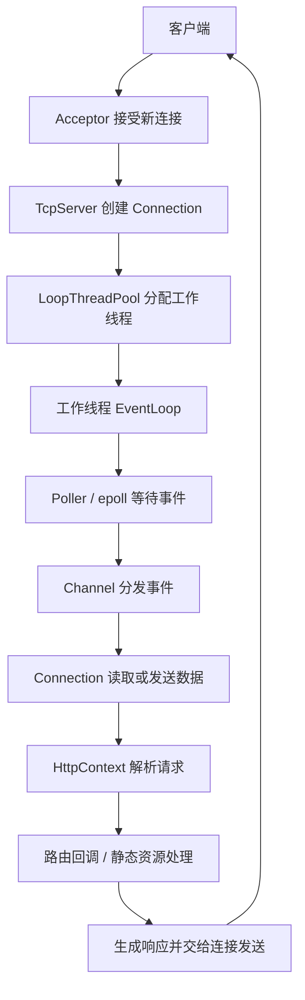

# ReactorHttpServer

基于 **C++11、Linux epoll 和多线程 Reactor 模型**实现的 HTTP 服务器学习项目。

项目参考 muduo 的 Reactor 设计思路，从 Socket、缓冲区和事件管理开始，逐步实现事件循环、连接管理、时间轮，以及 HTTP 请求解析和路由。网络层使用 Linux 系统调用与 C++ 标准库实现。

## 功能

- **事件驱动网络通信**：使用 epoll 监控事件，通过 Channel 调用对应的处理函数。
- **多线程 Reactor**：主事件循环接受新连接，将连接分配给工作线程的事件循环处理。
- **跨线程任务调度**：使用任务队列和 eventfd，将任务交给所属 EventLoop 执行。
- **连接与缓冲区管理**：使用读写缓冲区保存接收的数据和待发送的数据，管理连接建立、发送和关闭流程。
- **空闲连接超时**：使用 timerfd 和时间轮管理定时任务，连接有活动时刷新计时，空闲超时后安排关闭。
- **HTTP 请求解析**：按请求行、请求头和正文逐步解析，按 Content-Length 接收正文。
- **HTTP 路由与响应**：提供 GET、POST、PUT、DELETE 路由注册，支持响应头、状态码和正文的组织。
- **静态资源访问**：从配置的 wwwroot 目录读取文件并返回响应。
- **连接复用**：提供 Connection: keep-alive 和 Connection: close 对应的处理逻辑。

## 整体结构



| 模块 | 作用 |
| --- | --- |
| `Buffer` | 管理可读数据、可写空间及读写位置 |
| `Socket` | 封装创建、连接、监听、接收、发送和关闭操作 |
| `Channel` | 保存 fd、关注事件、就绪事件及对应回调 |
| `Poller` | 管理 epoll 注册，收集就绪 Channel |
| `EventLoop` | 循环处理就绪事件和任务队列 |
| `LoopThread / LoopThreadPool` | 创建工作线程及其事件循环，分配连接 |
| `TimerTask / TimerWheel` | 管理定时任务和空闲连接超时 |
| `Connection` | 管理单个 TCP 连接的状态、缓冲区、事件及业务上下文 |
| `Acceptor / TcpServer` | 接受新连接，组织线程池和连接集合 |
| `HttpRequest / HttpResponse / HttpContext` | 保存请求与响应信息，维护请求解析状态 |
| `HttpServer` | 将网络层与 HTTP 路由、静态资源处理连接起来 |

### 连接释放与超时

EventLoop 会先取出一批就绪的 Channel，再逐个处理。在这批事件处理期间，直接销毁连接可能使尚未处理的 Channel 指针失效。因此，连接的释放请求通过任务队列延后处理，并在排队期间保持连接对象存活。

时间轮使用共享指针管理任务。刷新时，将同一个任务放入未来的槽位；旧槽位清空时，如果新槽位仍持有任务，任务就不会销毁。连接正常关闭时取消超时任务，空闲到期时执行关闭任务。

## 目录结构

```text
ReactorHttpServer/
├── README.md
├── source/
│   ├── server.hpp             # 网络层、事件循环、连接管理和时间轮
│   └── http/
│       ├── http.hpp           # HTTP 解析、响应、路由和静态资源处理
│       ├── main.cc            # 示例服务器入口
│       ├── Makefile
│       └── wwwroot/
│           └── index.html     # 示例静态页面
└── test/
    ├── Makefile
    ├── client1.cpp
    ├── client2.cpp
    ├── client3.cpp
    ├── client4.cpp
    ├── client5.cpp
    └── client6.cpp            # 客户端测试程序
```

## 编译与运行

### 环境

- Linux，支持 epoll、eventfd、timerfd 等系统接口。
- 支持 C++11 的 g++ 编译器及线程支持。
- Git；使用 Makefile 时需要 make。
- curl 用于手动验证 HTTP 响应，WebBench 用于并发测试，需要另外安装或编译。

### 获取源码

```bash
git clone https://github.com/MTeng-code/ReactorHttpServer.git
cd ReactorHttpServer/source/http
```

### 编译并启动

```bash
g++ -std=c++11 -g -O0 -pthread main.cc -o main
./main
```

也可以使用仓库中的 Makefile：

```bash
make -B
./main
```

当前 Makefile 只列出了 main.cc 依赖。修改头文件后，可使用 `make -B` 强制重新编译，或直接执行上面的 g++ 命令。

请在 `source/http` 目录启动程序，示例使用相对路径 `./wwwroot` 查找静态资源。

### 默认配置

| 配置项 | 默认值 | 配置位置 |
| --- | --- | --- |
| 监听端口 | `8080` | `source/http/main.cc` |
| 工作线程数 | `3` | `SetThreadCount(3)` |
| 空闲超时 | `10` 秒 | `HttpServer` 构造参数，默认值定义在 `http.hpp` |
| 静态资源目录 | `./wwwroot` | `SetBaseDir()` |

例如，可以通过以下配置调整端口、工作线程数和空闲超时：

```cpp
HttpServer server(8080, 10);
server.SetThreadCount(3);
server.SetBaseDir("./wwwroot");
```

## 示例接口

示例入口注册了以下接口：

| 方法 | 路径 | 示例行为 |
| --- | --- | --- |
| GET | `/hello` | 返回请求信息 |
| POST | `/login` | 返回请求方法、路径和正文信息，用于演示正文解析 |
| PUT | `/update.txt` | 将请求正文写入 `wwwroot/update.txt` |
| DELETE | `/delete` | 返回请求信息，用于演示 DELETE 路由 |
| GET | `/` | 访问静态资源目录中的 `index.html` |

`/login` 是请求解析示例，尚未实现用户认证；`/delete` 当前演示路由分发，不执行文件删除。

在另一个终端验证 GET 请求：

```bash
curl -i --max-time 5 -H 'Connection: close' \
  http://127.0.0.1:8080/hello
```

验证 POST 正文解析：

```bash
curl -i --max-time 5 -H 'Connection: close' \
  --data 'username=test&message=hello' \
  http://127.0.0.1:8080/login
```

访问静态页面：

```bash
curl -i --max-time 5 -H 'Connection: close' \
  http://127.0.0.1:8080/
```

## 测试与调试

### 客户端测试程序

进入 test 目录，按需编译对应客户端。例如，从仓库根目录执行：

```bash
cd test
g++ -std=c++11 -g -O0 -pthread client4.cpp -o client4
./client4
```

测试前检查客户端中的端口、Content-Length、实际发送的正文以及发送间隔。声明正文长度后不发送足量数据，会让服务器继续等待正文；如果用于验证超时，这是有意构造的未完成请求。

### 手动验证场景

| 场景 | 检查重点 |
| --- | --- |
| 普通 GET 请求 | 响应状态和正文是否正确 |
| 不存在的资源 | 是否返回相应错误响应，服务器是否继续工作 |
| Keep-Alive 请求 | 同一连接能否复用，响应是否完整 |
| 每隔 3 秒通信，持续超过 10 秒 | 活跃连接是否被正确续期 |
| 请求后空闲超过 10 秒 | 空闲连接是否被关闭 |
| 建立连接但不发数据 | 是否触发空闲超时 |
| 请求头或正文只发送一部分 | 是否等待剩余内容，并在空闲超时后关闭 |
| 客户端提前退出 | 是否正确处理断开，避免崩溃或持续空转 |
| 并发测试结束后再次发请求 | 服务是否仍能正常响应 |

超时用例应按实际配置调整等待时间，测试程序也需要区分接收数据、对端关闭和接收错误。

### GDB

在 source/http 目录使用调试构建：

```bash
g++ -std=c++11 -g -O0 -pthread main.cc -o main
gdb -q -ex "set pagination off" ./main
```

进入 GDB 后执行 `run`。如果程序异常停止，用以下命令获取调用栈：

```text
bt
thread apply all bt
```

### 内存错误检查

```bash
g++ -std=c++11 -g -O0 -pthread \
  -fsanitize=address,undefined -fno-omit-frame-pointer \
  main.cc -o main-asan
./main-asan
```

使用这个版本重复功能和并发测试，观察是否出现访问已释放内存、越界访问或未定义行为报告。

## 并发测试记录

2026-10-24 的一次手动测试使用以下命令：

```bash
./webbench -c 10000 -t 60 http://127.0.0.1:8080/hello
```

输出：

```text
Speed=19364 pages/min, 53940 bytes/sec.
Requests: 19364 susceed, 0 failed.
```

| 项目 | 记录 |
| --- | --- |
| WebBench 并发客户端参数 | `10000` |
| 持续时间 | `60` 秒 |
| 请求 | `GET /hello HTTP/1.0` |
| 工具报告成功数 | `19364` |
| 工具报告失败数 | `0` |
| 按本轮成功数计算的平均请求数 | 约 `323` 次/秒 |
| 运行方式 | 服务器在 GDB 下运行，客户端访问本机回环地址 |

该记录用于观察一次调试场景下的请求完成情况与稳定性。`10000` 是客户端并发参数，不代表每秒处理一万次请求，也不代表已测得服务器吞吐上限。硬件、资源限制及完整环境配置尚未整理，因此该结果不用于跨项目性能比较。WebBench 的成功计数也不能替代对 HTTP 状态码与正文的功能检查。

## 后续改进方向

- 将现有手动验证场景整理为可重复运行的回归测试。
- 完善 HTTP 异常输入、消息边界及连接关闭边界的处理与测试。
- 完善 Makefile 的头文件依赖管理。
- 减少高频同步日志输出，统一日志等级和格式。
- 在记录硬件、编译参数和资源限制的条件下，补充吞吐量与延迟测试。

项目目前聚焦 Reactor 网络编程与 HTTP 基础实现，尚未实现 TLS、HTTP/2 或完整的 HTTP/1.1 协议覆盖。
